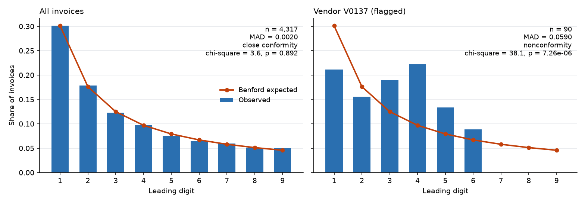

# audit-analytics-recipes

Full-population internal audit tests written as DuckDB SQL plus a little Python. They run
against a bundled synthetic dataset with known injected anomalies, so I can measure each test's
detection against ground truth.

> Synthetic data only. No real company data.

## Why I built this

In audit work I kept seeing analytics tests that were run once, their results pasted into a
workpaper, and the logic never reviewed. I could not tell whether a test was any good, because
nobody knew what it should have found. So I wrote each test as a small SQL file with its risk and
logic documented, and generated data where I know the answers. That lets me report precision and
recall per test instead of just a count of exceptions.

## Why full population

Sampling checks perhaps 25 to 60 items and extrapolates. A rule over every record finds a rare
event if it exists: one duplicate payment among 4,000 invoices is invisible to a sample of 40
and certain to be caught by a rule over all of them. The findings are exact items to follow up,
not an error-rate estimate. And the tests are code, so they can be re-run, reviewed and
versioned.

Sampling still has a place for judgement-heavy attributes, such as whether the contract supports
the price. These recipes cover the rule-based tests where reading all the data is cheap.

## Test catalogue

| Test | Risk | Logic | SQL file |
|---|---|---|---|
| `dup_invoice_exact` | Double payment | Same vendor, invoice number and amount | [01](sql/01_duplicate_invoices_exact.sql) |
| `dup_invoice_fuzzy` | Double payment, vendor master duplicates | Same amount, dates within 7 days, same or near-identical vendor name (Jaro-Winkler 0.92) | [02](sql/02_duplicate_invoices_fuzzy.sql) |
| `split_purchase` | Approval-limit avoidance | POs at 70-100% of the 10,000 limit, same requester and vendor within 7 days, sum over limit | [03](sql/03_split_purchases.sql) |
| `bank_change_payment` | Payment diversion fraud | Payment to the new IBAN within 14 days of a bank-detail change | [04](sql/04_payment_after_bank_change.sql) |
| `je_round_amount` | Management override, plugs | Manual journal of 5,000+ that is a multiple of 1,000 | [05](sql/05_journal_round_amounts.sql) |
| `je_weekend_holiday` | Unreviewed postings | Manual journal posted on a weekend or public holiday | [06](sql/06_journal_weekend_holiday.sql) |
| `je_unauthorized_poster` | Access control failure | Manual journal posted by a user with no `post_journal` permission | [07](sql/07_journal_unauthorized_poster.sql) |
| `leaver_active_account` | Unauthorised access | Account ACTIVE although the HR leave date has passed | [08](sql/08_leavers_active_accounts.sql) |
| `dormant_privileged_account` | Unmonitored access | Active privileged account idle over 90 days | [09](sql/09_dormant_privileged_accounts.sql) |
| `sod_conflict` | Fraud, error | User holds both roles of a pair in the SoD matrix | [10](sql/10_sod_conflicts.sql) |
| `benford_vendor` | Fabricated amounts | Vendor with 40+ invoices rejects Benford's law (chi-square p < 0.001) | [11](sql/11_benford_first_digit.sql) |

Each SQL file documents its risk, logic and output. Thresholds come from the `params` table in
[`sql/00_setup.sql`](sql/00_setup.sql).

## Quickstart

Requires Python 3.12+.

```bash
python3 -m venv .venv && source .venv/bin/activate
pip install -e ".[dev]"

audit-recipes generate --seed 42 --out data/     # regenerate the sample (same seed, same files)
audit-recipes run --data data/ --out output/findings.csv
audit-recipes evaluate --data data/              # precision / recall per test
audit-recipes benford --data data/               # chi-square, MAD, docs/benford_invoices.png
pytest && ruff check .
```

The tests also run in any DuckDB session: `.read sql/00_setup.sql` then `.read sql/01_...sql`.

The dataset is one fictional company for FY2025: 137 vendors with bank-change history, 4,069
purchase orders, 4,317 invoices, 4,117 payments, 9,598 general-ledger journals, 160 employees,
user accounts, roles, permissions and a segregation-of-duties matrix. The injected anomalies are
listed in `data/anomaly_labels.csv`. It is the ground truth, and the SQL never reads it.

## Evaluation results

Output of `audit-recipes evaluate --data data/ --markdown` on the committed sample (seed 42).
I re-ran it before writing this and the table matches.

| test_id | injected | flagged | tp | fp | fn | precision | recall | f1 |
|---|---|---|---|---|---|---|---|---|
| dup_invoice_exact | 25 | 25 | 25 | 0 | 0 | 1.0 | 1.0 | 1.0 |
| dup_invoice_fuzzy | 24 | 20 | 20 | 0 | 4 | 1.0 | 0.833 | 0.909 |
| split_purchase | 61 | 67 | 54 | 13 | 7 | 0.806 | 0.885 | 0.844 |
| bank_change_payment | 12 | 40 | 10 | 30 | 2 | 0.25 | 0.833 | 0.385 |
| je_round_amount | 22 | 25 | 21 | 4 | 1 | 0.84 | 0.955 | 0.894 |
| je_weekend_holiday | 18 | 23 | 18 | 5 | 0 | 0.783 | 1.0 | 0.878 |
| je_unauthorized_poster | 15 | 15 | 15 | 0 | 0 | 1.0 | 1.0 | 1.0 |
| leaver_active_account | 5 | 5 | 5 | 0 | 0 | 1.0 | 1.0 | 1.0 |
| dormant_privileged_account | 5 | 5 | 5 | 0 | 0 | 1.0 | 1.0 | 1.0 |
| sod_conflict | 10 | 10 | 10 | 0 | 0 | 1.0 | 1.0 | 1.0 |
| benford_vendor | 1 | 2 | 1 | 1 | 0 | 0.5 | 1.0 | 0.667 |

Precision is below 1 where the rule is a real risk indicator that also fires on benign activity.
I put that activity in on purpose: ordinary payments after a bank change, repeat purchases just
under the limit, month-end postings on a Saturday, one-off round accruals. Recall is below 1
where I injected cases just outside a threshold: invoices copied more than 7 days apart,
payments more than 14 days after a change, round amounts in multiples of 500. The one
`benford_vendor` false positive is a vendor whose invoices cluster under the approval limit
because of the injected split purchases. These numbers describe this synthetic dataset, not
real-world detection rates.

## Benford's law

First-digit analysis with a chi-square test (8 degrees of freedom) and mean absolute deviation
(MAD) against Nigrini's thresholds: up to 0.006 close conformity, 0.012 acceptable, 0.015
marginal, above that nonconformity. Left: all invoices (log-uniform by construction, so close
conformity). Right: the injected vendor with fabricated amounts.



## Limitations

- Synthetic data is cleaner than real ledgers. The thresholds are illustrative and need tuning
  on real data, where I would expect lower precision.
- Precision and recall depend on how I injected the anomalies. They are useful for comparing
  rule versions on this dataset, not for comparing across datasets.
- Rules flag items for review. They do not prove error or fraud.
- Fuzzy matching uses normalised names and a fixed similarity cutoff, so it misses heavier
  variants.
- Benford's law suits wide-ranging amounts. It is unreliable for capped, fixed-price or small
  populations, and the vendor test only applies to vendors with 40+ invoices.
- Single currency, single fiscal year, no tax or multi-entity logic. Not production software.

By Utku Fidan · [utkufidan.com](https://utkufidan.com)
